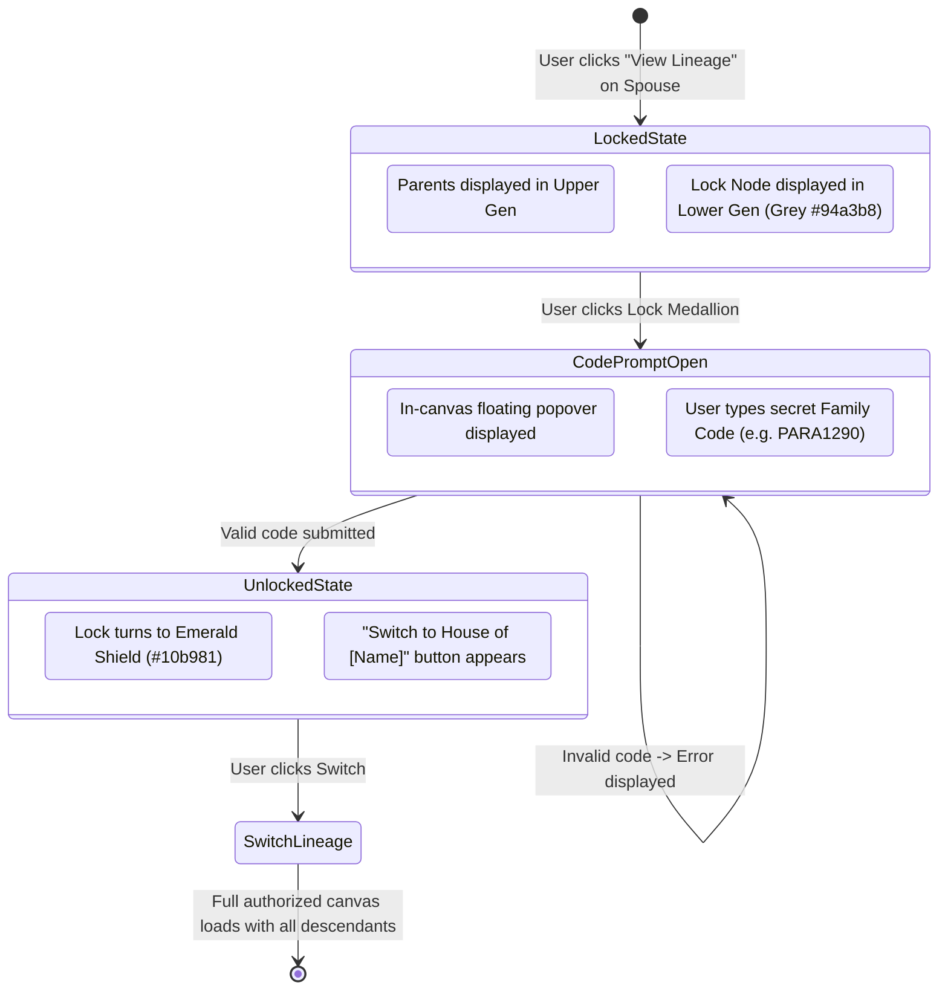

# Architecture Specification: Privacy Model & Family Access Codes

> **Document ID**: `ARCH-003`  
> **Status**: Active / Source of Truth  
> **Last Updated**: 2026-11-20  

---

## 1. Core Intent: Protecting Living Relatives and Descendants

In cultural and family heritage platforms, personal data privacy is paramount. Unlike historical databases of centuries-old ancestors, modern family trees contain **living relatives, young children, daughters, and sons**.

### The Privacy Problem Without Access Control:
When two families intermarry, allowing users from Family A (e.g., Konukuru) to freely browse all descendants, daughters, and sons of Family B (e.g., Paradarami) without consent constitutes an unacceptable privacy violation:
- Living daughters and sons may not want their contact info, photos, or biographical records visible to unrelated in-law circles.
- Collateral branches (uncles, aunts, cousins, nephews, nieces) have not necessarily consented to sharing their data with an in-law's extended family.

**The Solution**: Lineage-specific **Family Access Codes** (e.g., `KONU1290` for House of Konukuru, `PARA1290` for House of Paradarami).

```
   ┌────────────────────────────────────────────────────────┐
   │             HOUSE OF KONUKURU CANVAS                   │
   │                                                        │
   │   [Murthy Chetty & Sarojamma]  (Silent Gen - Unlocked) │
   │                │                                       │
   │   [Jagannadham] ════ [Suguna]  (Gen X - Unlocked)      │
   │          │               │                             │
   │          │          [Ramayya Chetty & Achamma]         │
   │          │          (Baby Boomers - VISIBLE ANCESTORS) │
   │          │               │                             │
   │          ▼               ▼                             │
   │     [Children]       [ 🔒 HOUSE OF PARADARAMI LOCK ]   │
   │  (Meghana, Shanmuga) (Millennials - LOCKED)            │
   │                      (Protects Rada, Munirathnam,      │
   │                       Navaneeth until code entered)    │
   └────────────────────────────────────────────────────────┘
```

---

## 2. The Ancestral Visibility Rule: What is Shown vs. What is Locked

When an authorized user views a family canvas (e.g., Konukuru) and expands a spouse's lineage ("View Lineage" on Suguna), the system enforces the **Ancestral Visibility Rule**:

| Relational Category | Generational Horizon | Visibility Status | Rationale |
| :--- | :--- | :--- | :--- |
| **Direct Parents** | Upper Generation ($Y - 440\text{px}$) | **VISIBLE** | Cultural tradition requires knowing the roots and parents of a spouse. |
| **Direct Grandparents** | Upper Generation ($Y - 880\text{px}$) | **VISIBLE** (when recorded) | Ancestral heritage of the marrying individual. |
| **Great-Grandparents** | Upper Generation ($Y - 1320\text{px}$) | **VISIBLE** (when recorded) | Deep lineage historical roots. |
| **Spouse's Siblings** | Same Generation ($Y$) | **STRICTLY LOCKED** | Protects brothers and sisters from cross-lineage exposure. |
| **Spouse's In-Laws** | Same Generation ($Y$) | **STRICTLY LOCKED** | Spouses of siblings (e.g., brother-in-law Munirathnam Galeti). |
| **Next-Gen Descendants** | Lower Generation ($Y + 440\text{px}+$) | **STRICTLY LOCKED** | Protects nephews, nieces, and young cousins (e.g., Navaneeth Galeti). |

---

## 3. Placement & Styling of the Lineage Lock Node

### 3.1 Strict Lower-Generation Placement
In earlier prototype iterations, the lock node was mistakenly positioned in the upper generation (above the parents). This was fundamentally incorrect:
1. **Misleading Mental Model**: Placing a lock above parents makes users believe the *ancestors* are locked or missing.
2. **Correct Generational Logic**: The ancestors are *unlocked and visible*. What is actually gated are the **collateral branches and downstream descendants (sons and daughters)** of that house.
3. **The Rule**: The Lock Node **MUST ALWAYS** reside in the **LOWER generation** (later generations, e.g., Millennials / Gen Y at $Y = Y_{\text{target}} + 440\text{px}$), pointing downwards from the parental union.

### 3.2 Refined Grey Aesthetic (Anti-Alarmist)
The lineage lock node represents a dignified privacy seal, not a security hazard or form validation error:
- **Forbidden Colors**: Bright red (`#ef4444`, `#f87171`) is strictly prohibited for the lock medallion, border, and connector lines.
- **Mandatory Colors**: Elegant neutral slate grey:
  - **Medallion Border**: `2.5px solid #94a3b8`
  - **Medallion Shadow**: `0 0 20px rgba(148, 163, 184, 0.35), 0 4px 14px rgba(0,0,0,0.7)`
  - **Lock Icon**: `#94a3b8`
  - **Header Text**: `#cbd5e1`
  - **Connector Line**: `#94a3b8` dashed stroke (`strokeDasharray: '4 4'`)
  - **Unlocked State**: Emerald green (`#10b981`) upon successful verification.

---

## 4. Verification & State Transition Flow

The unlocking sequence operates with zero page reloads via React context (`LineageContext.tsx`):



### 4.1 Persistence & Session Scope
- Family codes are stored in browser session memory / state.
- Once unlocked, the lineage ID is appended to `unlockedLineages: string[]`.
- Unlocking persists across navigations during the session, allowing instant exploration between authorized houses without repeatedly re-entering the code.

