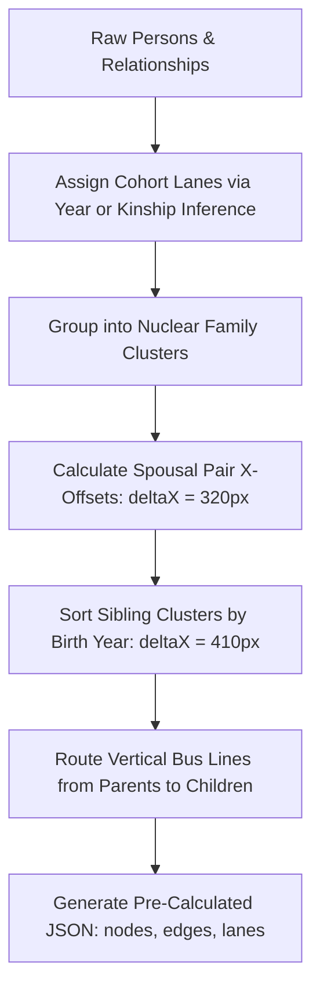

# Architecture Specification: Data Model & Graph Partitioning

> **Document ID**: `ARCH-004`  
> **Status**: Active / Source of Truth  
> **Last Updated**: 2026-11-20  

---

## 1. Single Source of Truth: Canonical Database

All family data across all houses is persisted within a unified, atomic relational store:
- `data/persons.json`: Canonical person records.
- `data/relationships.json`: Canonical relationship records.

### 1.1 Person Schema Contract
```typescript
export interface Person {
  id: string;                     // Permanent UUID v4
  first_name: string;             // Given name (Line 1 on canvas)
  middle_name: string | null;     // Optional middle name
  last_name: string;              // Surname / House Name (Line 2 on canvas)
  alias: string | null;           // Traditional moniker or nickname
  gender: 'male' | 'female' | 'other';
  birth_date: string | null;      // ISO 8601 YYYY-MM-DD or YYYY
  death_date: string | null;      // ISO 8601 or null if living
  birth_place: string | null;     // Historical ancestral village/town
  death_place: string | null;
  profile_photo: string | null;   // Path or URL to portrait image
  biography: string;              // Biographical narrative
  is_living: boolean;             // false renders † Deceased on canvas
  is_archived: boolean;           // Soft delete flag
  created_at: string;
  updated_at: string;
}
```

### 1.2 Relationship Schema Contract
```typescript
export interface Relationship {
  id: string;                     // Permanent UUID v4
  person_id: string;              // Subject person UUID
  related_person_id: string;      // Related person UUID
  relationship_type: 'parent' | 'spouse';
  parent_type: 'biological' | 'adoptive' | null;
  start_date: string | null;
  end_date: string | null;        // Termination date (e.g. death of spouse)
  notes: string;
  created_at: string;
}
```

---

## 2. Deterministic Graph Partitioning per House

A core strength of the architecture is that **multiple houses share the same unified database without data duplication**.

The backend Graph Service (`functions/src/graph/graph.service.ts`) executes deterministic partitioning based on the requested `lineage` query parameter:

```
                          CANONICAL DATABASE
                (19 Persons, 29 Relationships Store)
                                │
       ┌────────────────────────┴────────────────────────┐
       ▼                                                 ▼
QUERY: ?lineage=konukuru                          QUERY: ?lineage=paradarami
┌──────────────────────────────┐                  ┌──────────────────────────────┐
│ • Murthy Chetty & Sarojamma  │                  │ • Ramayya Chetty & Achamma   │
│ • Chandra, Dana, Rajini,     │                  │ • Rada Galeti & Munirathnam  │
│   Giri, Chandrakala          │                  │ • Navaneeth Galeti           │
│ • Jagannadham (Son)          │                  │ • Suguna (Daughter)          │
│ • Suguna (In-Law Spouse)     │                  │ • Jagannadham (In-Law Spouse)│
│ • Meghana & Shanmuga         │                  │ • View Lineage on Jagannadham│
│ • Hemanth, Revati, Pranavi   │                  │                              │
│ • View Lineage on Suguna     │                  │                              │
└──────────────────────────────┘                  └──────────────────────────────┘
```

### Partitioning Rules:
1. **House Boundary Inclusion**: All direct blood descendants and primary patriarchs of the target house are included.
2. **Spouse Bridge Inclusion**: The direct spouse of a house member is included so marital unions are complete.
3. **External Ancestor Exclusion**: The parents, siblings, and collateral relatives of the incoming spouse are **excluded from the default partition layout**. They are loaded only on demand via the in-canvas "View Lineage" bridge.

---

## 3. Deterministic Layout Engine

The layout engine (`functions/src/layout/layout.service.ts`) converts an abstract graph of people and relationships into a mathematically deterministic 2D grid:

### 3.1 Layout Pipeline Stages


### 3.2 Standard Layout Metrics

| Geometric Attribute | Dimension Value | Description |
| :--- | :--- | :--- |
| **Node Width** | $190\text{px}$ | Standard width of a circular portrait card |
| **Node Height** | $160\text{px}$ | Standard height including circle, names, and status |
| **Lane Height** | $440\text{px}$ | Vertical pitch between consecutive generations |
| **Spouse Spacing** | $320\text{px}$ | Center-to-center distance between married spouses |
| **Inter-Cluster Spacing** | $410\text{px}$ | Clear gutter between adjacent sibling family units |
| **Vertical Edge Gutter** | $220\text{px}$ | Mid-lane horizontal bus level for parent-to-child drop lines |

---

## 4. Static Data Pre-Rendering for CDN & Hosting Reliability

To guarantee instant page loads and ensure total resilience on static CDN hosting (such as Firebase Hosting Spark tier without requiring cold-start cloud function execution on every page view):
1. The build script (`scripts/generate-static-data.cjs`) runs during `npm run build`.
2. It executes `calculateLayout(partitionedGraph, { inferGenerations: true })`.
3. It emits pre-rendered JSON files to `public/data/`:
   - `public/data/layout-konukuru.json`
   - `public/data/layout-paradarami.json`
   - `public/data/persons.json`
   - `public/data/relatives.json`
4. The client runtime seamlessly loads these pre-computed layouts, ensuring **sub-100ms first paint** while retaining 100% full interactive editing, in-canvas lineage expansion, and code unlocking capabilities.
